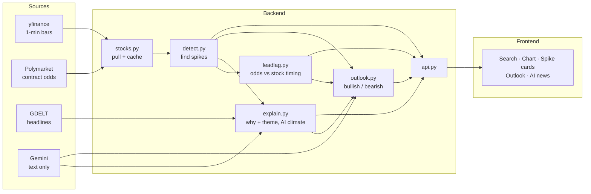
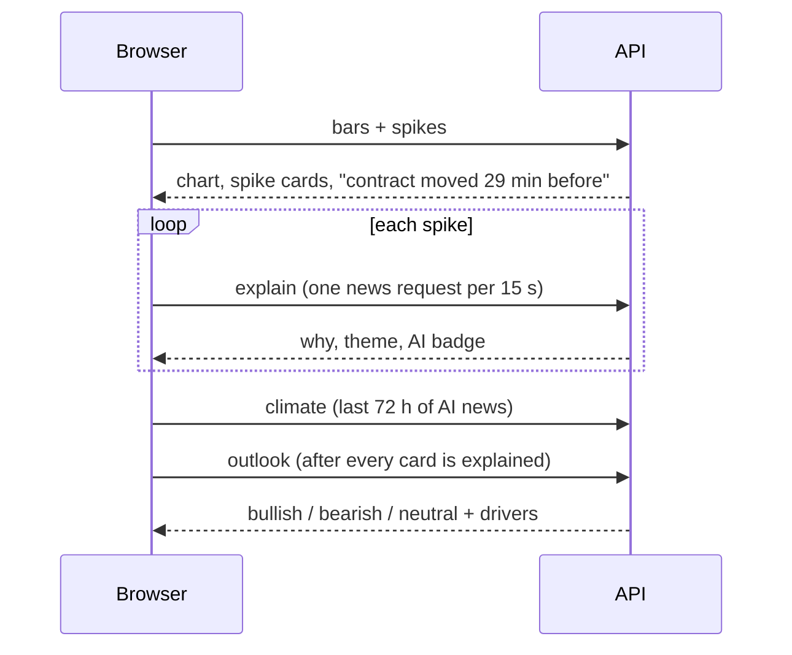
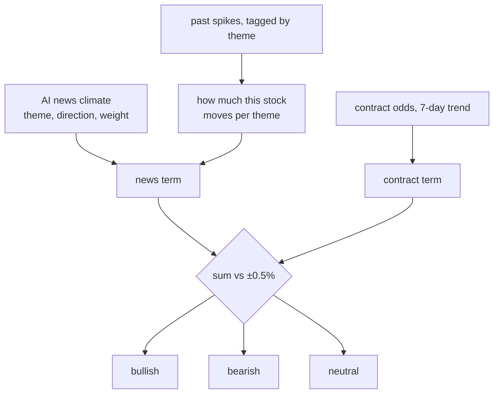

# Powerspike, in one page

Type a tech ticker. See every spike in its price, the news behind each one, whether the Polymarket
contract on the company moved first, and a bullish / bearish read for right now.

## Run it

```bash
cd backend && source ../.venv/bin/activate
uvicorn powerspike.api:app --port 8010
python scripts/warm_stocks.py NVDA TSLA AAPL MSFT --api http://localhost:8010   # slow news index: warm before a demo
```

Open http://localhost:8010/?t=NVDA

## The pieces



## One search



## The verdict



Confidence = size of the sum × how many spikes it rests on. The model writes the sentences; it
never picks the label.

## Spike rules

- Big: 15-minute move vs the last 4 hours, robust z ≥ 4. Overnight gaps are judged on their own scale.
- Real: volume 2× usual.
- Sticks: still there 30 minutes later.
- Calibrated on 30 days: NVDA 5, TSLA 12, AAPL 3, MSFT 7 spikes.

## Know before showing

- GDELT refuses most requests from this machine; a cold ticker is slow. Warm first.
- Contracts settle: MSFT's on Oct 19, TSLA's on Oct 30. Add a new leg in
  `backend/config/companies.yaml` (`python scripts/find_markets.py --event-slug <slug>`).
- Amazon and Meta have no usable contract; they still get spikes, news and an outlook.
- Not investment advice. Every card says so.

## Files

| What | Where |
|---|---|
| Companies and contracts | `backend/config/companies.yaml` |
| Detector | `backend/powerspike/detect.py` |
| Odds vs stock timing | `backend/powerspike/leadlag.py` |
| News and climate | `backend/powerspike/explain.py` |
| Verdict | `backend/powerspike/outlook.py` |
| API | `backend/powerspike/api.py` |
| Screen | `frontend/src/App.tsx`, `frontend/src/components/` |
| Decisions | `docs/superpowers/specs/2026-10-16-stock-pivot-design.md` |
